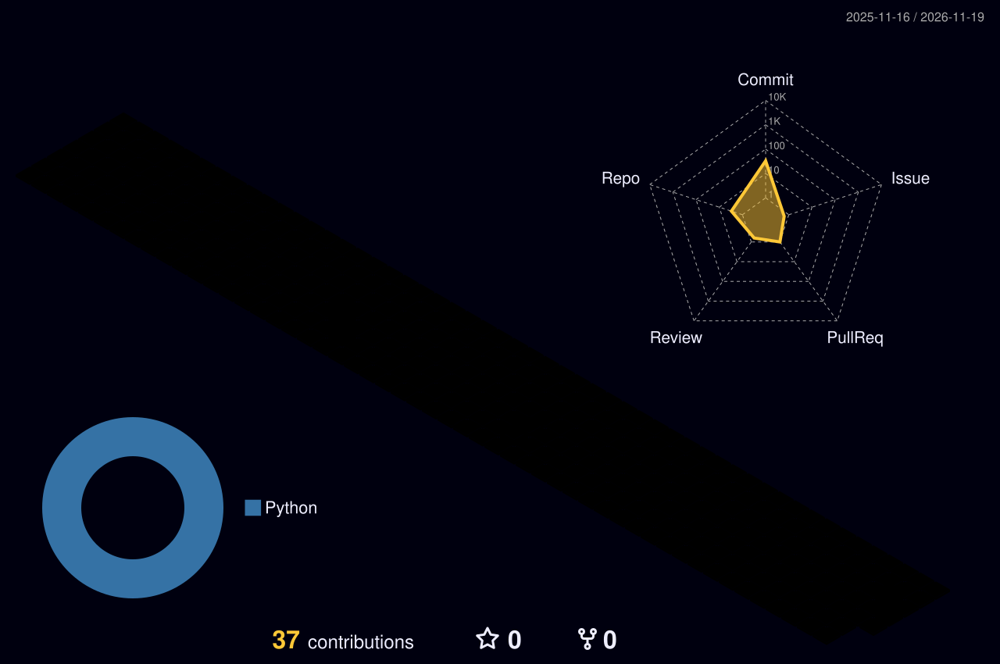

<!-- PROFILE HEADER -->

  
  
  

---

## 👨‍🚀 About Me

I'm **Deepak Kumar Vishwakarma**, a developer from India who enjoys turning ideas into practical software, interactive games, and electronics projects.

- 🔭 Currently building **innovative development projects**
- 🌱 Learning **advanced web development and game development**
- 🎮 Interested in **Unity, Unreal Engine, 3D workflows, and interactive experiences**
- ⚡ Exploring **IoT, embedded systems, and creative hardware projects**
- 🤝 Open to collaborating on **open-source and game-development projects**
- 💬 Ask me about **Python, C/C++, Java, React, Django, Unity, and Unreal Engine**
- 📫 **Email:** [dv2626637@gmail.com](mailto:dv2626637@gmail.com)

---

## 🧰 Tech Stack

| Area | Tools & Technologies |
|:--|:--|
| **Languages** |      |
| **Frontend** |    |
| **Backend & Data** |   |
| **Game & 3D** |    |
| **Tools** |    |

---

## 🚀 Featured Repositories

A few projects from my GitHub workspace:

---

## 📊 GitHub Analytics

 

 

---

## 🧊 3D Contribution Universe

## 🐍 Contribution Snake

---

## 🏆 Achievements

---

## 🤝 Connect With Me

  

**Thanks for visiting my profile!**

