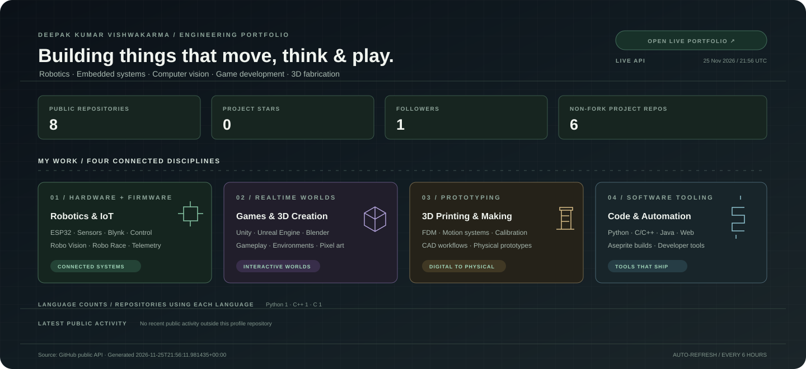
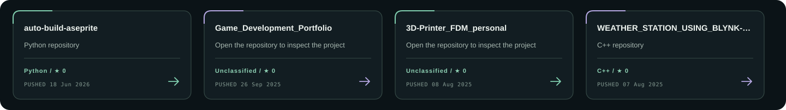

---

## About

I'm a developer and maker from India interested in building across the boundary of software and physical systems. My work spans embedded electronics, robotics, computer vision, game development, 3D content creation, fabrication and automation.

- **Build:** ESP32 projects, sensor systems, robot control and IoT prototypes
- **Create:** Unity / Unreal experiences, Blender assets, game environments and pixel-art workflows
- **Prototype:** FDM 3D printing, motion systems and hardware experiments
- **Automate:** Python utilities, build pipelines and developer tooling
- **Explore:** C/C++, Python, Java, React and Django

🌐 **Portfolio:** [portfolio-five-sigma-s3ior1g2jz.vercel.app](https://portfolio-five-sigma-s3ior1g2jz.vercel.app) — my dedicated project and personal website  
📫 **Contact:** [dv2626637@gmail.com](mailto:dv2626637@gmail.com)

## Engineering dashboard

## Areas of work

<table>
<tr>
<td width="50%" valign="top">

### Robotics & embedded systems
ESP32, sensor integration, motor control, telemetry, IoT dashboards and connected prototypes.

**Selected work:** [Robo Vision using VR](https://github.com/Deepak-Kumar-Vishwakarma/Deepak-Kumar-Vishwakarma-Robo-Vision-Using-VR) · [Robo Race](https://github.com/Deepak-Kumar-Vishwakarma/Robo-Race) · [Weather Station](https://github.com/Deepak-Kumar-Vishwakarma/WEATHER_STATION_USING_BLYNK-IOT)

</td>
<td width="50%" valign="top">

### Game development & 3D
Unity, Unreal Engine, Blender, game environments, asset workflows, animation and pixel-art production.

**Selected work:** [Game Development Portfolio](https://github.com/Deepak-Kumar-Vishwakarma/Game_Development_Portfolio)

</td>
</tr>
<tr>
<td width="50%" valign="top">

### Hardware & fabrication
FDM printing, mechanical prototyping, printer tuning, motion systems and design-to-build workflows.

**Selected work:** [Personal FDM 3D Printer](https://github.com/Deepak-Kumar-Vishwakarma/3D-Printer_FDM_personal)

</td>
<td width="50%" valign="top">

### Software & developer tools
Python, C/C++, Java, web technologies, automation and creative-tool build workflows.

**Selected work:** [Aseprite Auto Build](https://github.com/Deepak-Kumar-Vishwakarma/auto-build-aseprite) · [Aseprite Builder](https://github.com/Deepak-Kumar-Vishwakarma/aseprite-builder)

</td>
</tr>
</table>

## Selected public projects

The cards below link to public repositories. The first row highlights robotics and physical-computing work; the second covers game development and tooling. The compact panel below is regenerated from repository metadata by GitHub Actions.

[Browse all public repositories →](https://github.com/Deepak-Kumar-Vishwakarma?tab=repositories) · [Open live portfolio website →](https://portfolio-five-sigma-s3ior1g2jz.vercel.app)

## Technology

**Programming**

**Web development**

**Game development, 3D & hardware**

**Tools**

## GitHub activity

 

 

## Contribution visuals

---

*Thanks for visiting. Always building, testing and learning.*

