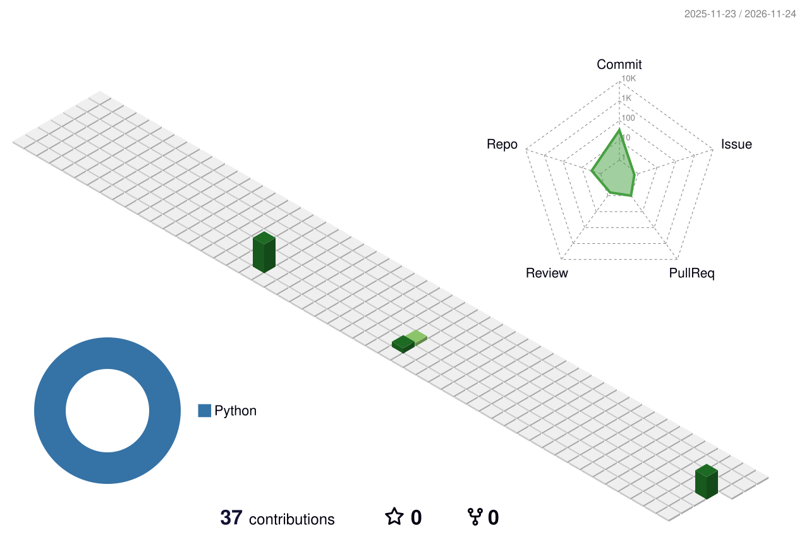

 

---

## 👋 Hey, I'm Deepak!

**Developer from India**, interested in building useful software and bringing ideas to life through robotics, embedded systems, game development and 3D creation.

- 🔭 Working on innovative software and engineering projects
- 🌱 Learning advanced web development and game development
- 🤖 Exploring robotics, ESP32, IoT and embedded systems
- 🎮 Interested in Unity, Unreal Engine, Blender and interactive experiences
- 🧩 Building with Python, C/C++, Java, JavaScript, React and Django
- 🤝 Open to open-source and game-development collaborations
- 📫 Reach me at **[dv2626637@gmail.com](mailto:dv2626637@gmail.com)**

---

## ⚡ What I Build

## 🧰 Technology Stack

**Languages**

**Web & Backend**

**Game Development, 3D & Hardware**

**Developer Tools**

---

## 🚀 Selected Projects

A selection from my 15 public repositories. Open each project to explore its code and documentation.

---

## 📊 GitHub Live Dashboard

 

 

---

## 🧊 3D Contribution World

Automatically regenerated every day with GitHub Actions.

## 🐍 Contribution Snake

---

## 🏆 GitHub Achievements

---

## 🌐 Connect

  

**Thanks for stopping by — let's build something great!**

